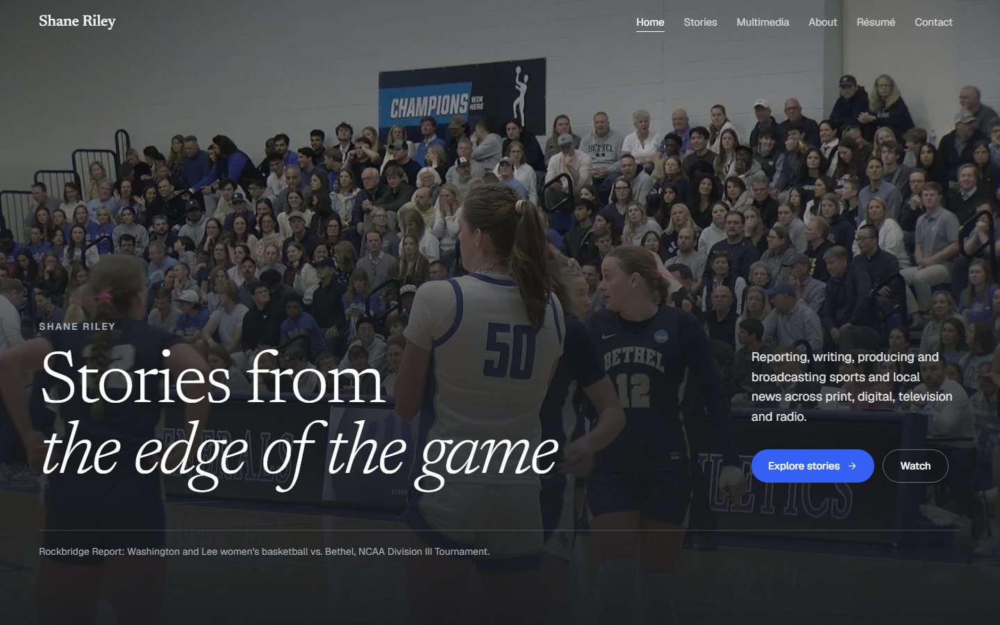
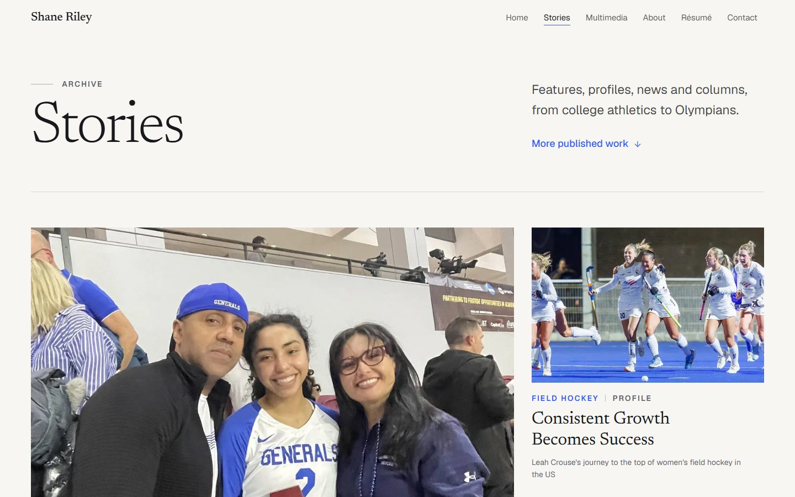
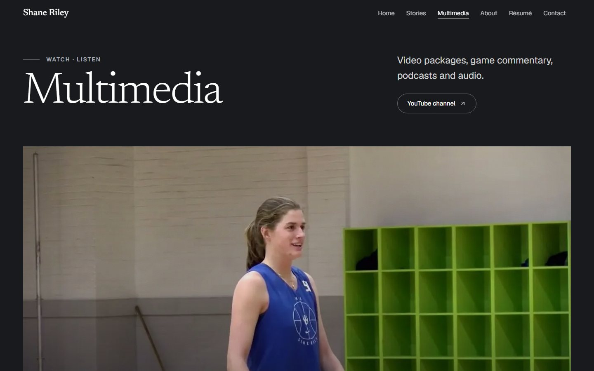

# Shane Riley — Sports Journalism Portfolio

**Live site: [shane-riley-website.vercel.app](https://shane-riley-website.vercel.app)**

The portfolio of Shane Riley, a sports journalist at Washington and Lee University: long-form stories, video packages, game commentary, a radio series, podcasts, biography, an HTML résumé and contact details. The site is fully statically generated, and Shane updates it himself through a no-code CMS.



<table>
  <tr>
    <td></td>
    <td></td>
  </tr>
</table>

## Highlights

- **Editorial design.** Magazine-style layouts, a restrained palette, a single serif and sans pairing, and subtle motion that respects `prefers-reduced-motion`.
- **Editable without code.** Shane edits text, photos, videos, audio and the résumé PDF through [Pages CMS](https://pagescms.org). Each save is a Git commit, and Vercel rebuilds the site.
- **Safe content pipeline.** CMS content is validated at build time. A missing field or photo stops the build with a plain-English message naming the field, and the live site keeps serving the last good version.
- **Fast.** Every page is static. Responsive WebP images are generated at build time, and YouTube embeds load only when a visitor presses play.
- **Accessible.** Semantic HTML, keyboard support, visible focus states, alt text on every photo, and automated axe checks in the test suite.
- **Secure.** Strict Content Security Policy and security headers, no cookies, no forms and no data collection.

## Tech stack

| Area | Tools |
| --- | --- |
| Framework | [Next.js 16](https://nextjs.org) (App Router, React Server Components), React 19, TypeScript |
| Styling | Tailwind CSS 4, design tokens in `globals.css` |
| Motion and icons | Motion for React, Lucide |
| Images | `sharp` build step producing responsive WebP, custom `next/image` loader |
| Content | JSON files edited through Pages CMS; stories as typed TypeScript blocks |
| Testing | Playwright end-to-end tests, axe-core accessibility checks, ESLint, `tsc` |
| Hosting | Vercel, deployed on every push to `main` |

## Pages

| Route | What it is |
| --- | --- |
| `/` | Full-screen hero, featured-story spread, multimedia teaser, about teaser, contact call to action |
| `/stories` | All 11 stories, plus links to Shane's articles at The Ring-tum Phi and the Rockbridge Report |
| `/stories/[slug]` | Long-form article: byline, photo captions, floated photos and galleries with a lightbox, click-to-load video, audio, share controls, reading progress |
| `/multimedia` | Video packages, game-commentary playlists, the Sports Flash radio series, podcasts and audio |
| `/about` | Biography, portrait, interests, experience timeline |
| `/resume` | Printable HTML résumé with a Download PDF button |
| `/contact` | Email link and social profiles |

## How content is edited

```
Pages CMS form  ──save──▶  commit to src/content/data/*.json  ──▶  Vercel build  ──▶  live site
                                                                    │
                                              validation fails? ────┘ build stops, live site unchanged
```

| Content | Where it lives | Edited in |
| --- | --- | --- |
| Profile, links, home, about, contact wording | `src/content/data/{site,home,about,contact}.json` | Pages CMS |
| Résumé and PDF | `src/content/data/resume.json`, `public/resume/` | Pages CMS |
| Videos, commentary, podcasts, audio | `src/content/data/multimedia.json` | Pages CMS |
| Sports Flash radio segments | `src/content/data/sports-flash.json`, `public/audio/sports-flash/` | Pages CMS |
| Articles at other outlets | `src/content/data/published.json` | Pages CMS |
| Full stories (text with photos between paragraphs) | `src/content/stories.ts` | Code |
| Photos and video thumbnails | `src/assets/photos/`, `src/assets/posters/` | Pages CMS uploads |

The CMS forms are defined in [`.pages.yml`](.pages.yml). The TypeScript modules in `src/content/*.ts` read the JSON, validate it and turn it into the types the pages use.

- **For editors:** [docs/EDITING.md](docs/EDITING.md) explains how to sign in and make changes, without any code.
- **For developers:** [docs/CONTENT_GUIDE.md](docs/CONTENT_GUIDE.md) covers adding stories and media by hand.

## Project structure

```
src/
  app/            Routes (App Router), metadata, sitemap, robots, Open Graph image
  components/     Layout, media players, gallery, story rendering, motion, UI primitives
  content/        Content modules; data/ holds the CMS-edited JSON
  assets/         Original photos and video thumbnails
  lib/            Helpers and the custom image loader
public/           Audio, video and the résumé PDF
scripts/          Build-time image generation
tests/            Playwright end-to-end and accessibility tests
docs/             Architecture, design system, content, performance, accessibility, security, deployment
archive/          Full-quality originals not used by the site
```

## Run it locally

Requires Node.js 20.9 or newer and npm.

```bash
npm install
npm run dev          # generates images, then starts http://localhost:3000
```

To preview the production build:

```bash
npm run build
npm run start        # http://localhost:3000
```

## Checks

```bash
npm run typecheck    # TypeScript
npm run lint         # ESLint (Next.js core-web-vitals + TypeScript rules)
npm run build        # production build
npm run test:e2e     # Playwright + axe tests against the production build
npm run check        # all of the above, in order
```

`test:e2e` uses your installed Google Chrome and starts `next start` itself unless a server is already running on port 3000. To use Playwright's bundled Chromium instead, run `npx playwright install chromium`, then `PW_CHANNEL= npm run test:e2e`.

## Deployment

The site deploys to Vercel on every push to `main`, including saves from the CMS. Set `NEXT_PUBLIC_SITE_URL` to the production URL so canonical links, the sitemap and share previews are correct. See [docs/DEPLOYMENT.md](docs/DEPLOYMENT.md) for environment variables, custom domains, HTTPS and the launch checklist.

## Documentation

- [Architecture](docs/ARCHITECTURE.md): structure, routing, content flow and dependencies
- [Design system](docs/DESIGN_SYSTEM.md): tokens, type, spacing, components and motion
- [Editing guide](docs/EDITING.md): using the CMS (for non-developers)
- [Content guide](docs/CONTENT_GUIDE.md): stories, videos, photos and the résumé, by hand
- [Performance](docs/PERFORMANCE.md): optimisations and measured Lighthouse results
- [Accessibility](docs/ACCESSIBILITY.md): approach and the checks that were run
- [Security](docs/SECURITY.md): threat model, headers, CSP and known limitations
- [Deployment](docs/DEPLOYMENT.md): hosting, environment variables and the launch checklist

## Credits

Designed and built by **Luis Coronel**, with help from Claude Code. All journalism, photography, video and audio is by **Shane Riley** unless credited otherwise on the site.

## License

The **source code** is released under the [MIT License](LICENSE).

The **content is not**: stories, photographs, video, audio, the résumé and other personal information in `src/content/`, `src/assets/`, `public/` and `archive/` are © Shane Riley or their credited owners, all rights reserved. Please don't reuse them without permission. If you build on this code, replace the content with your own.
